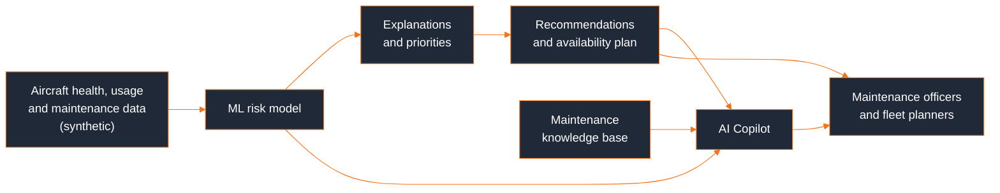
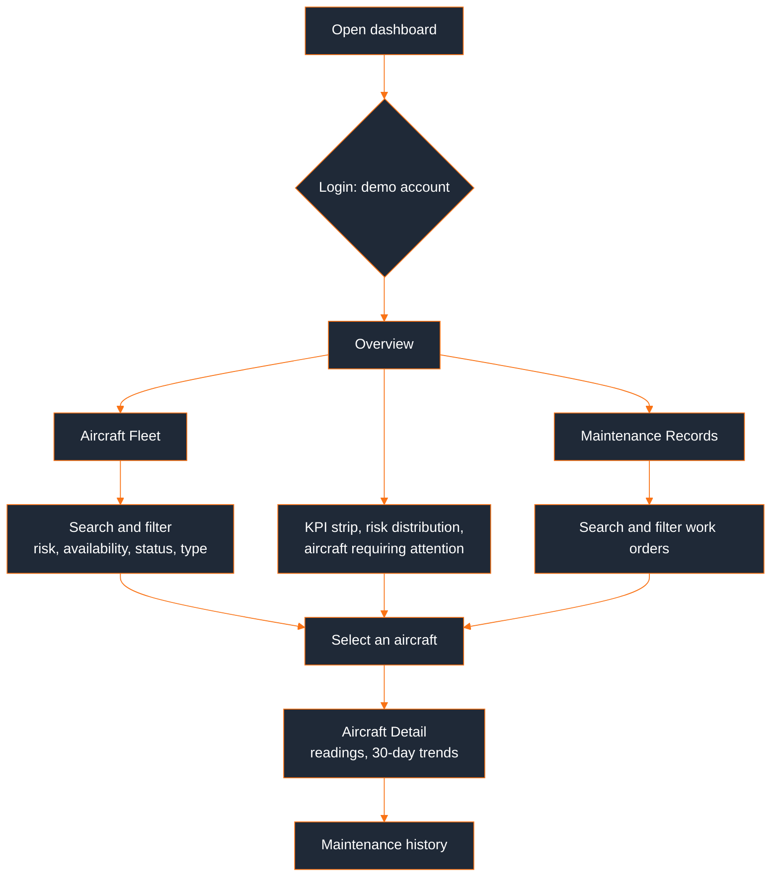
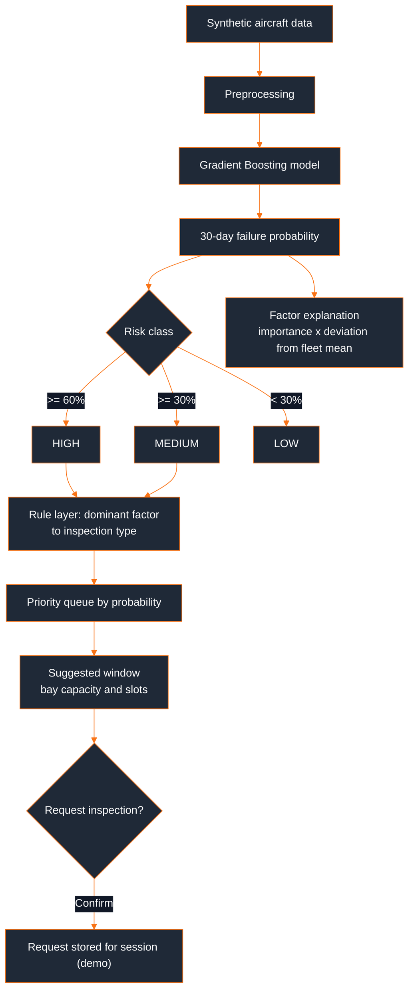
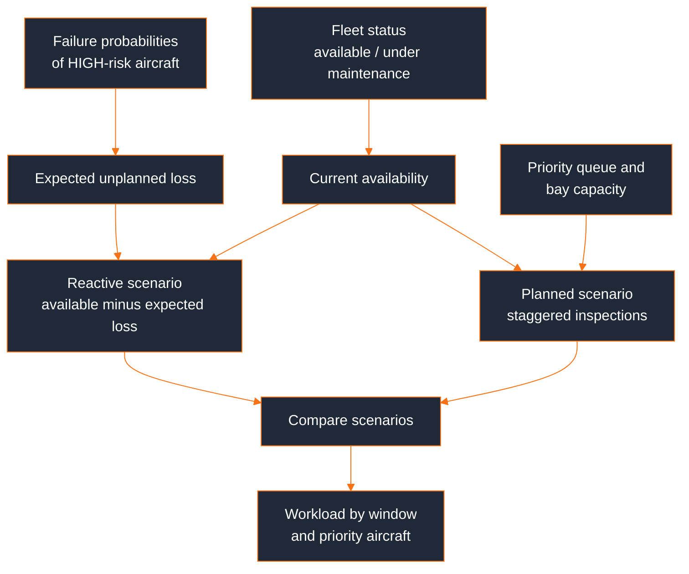
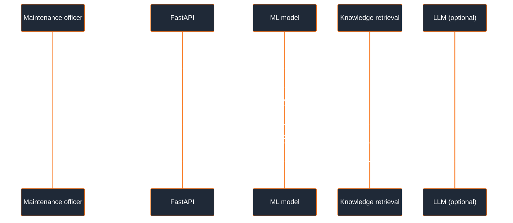
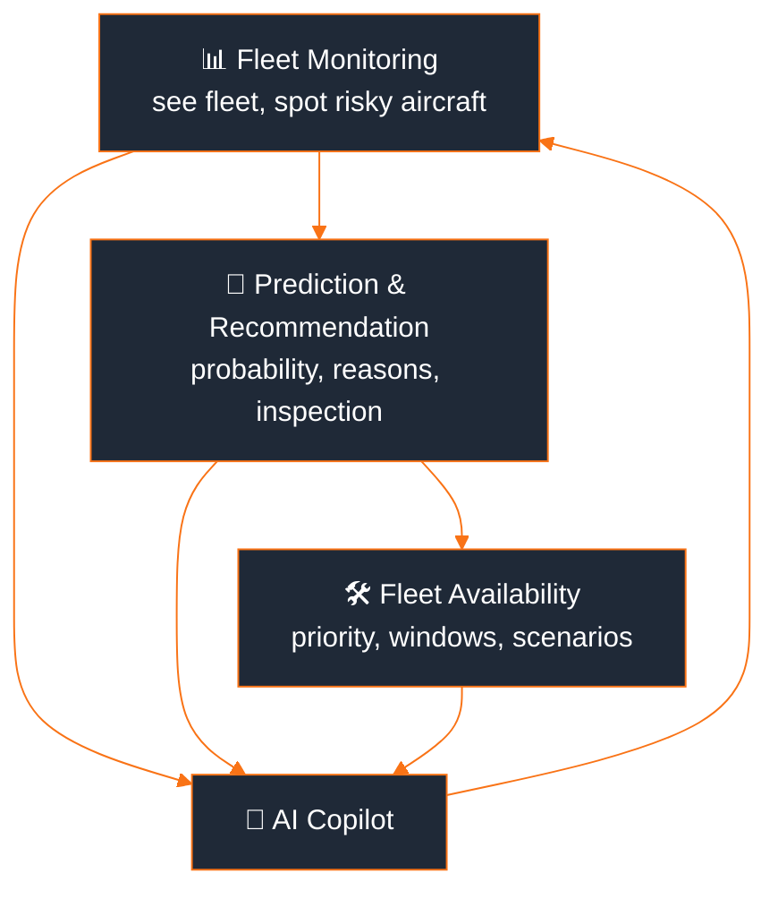
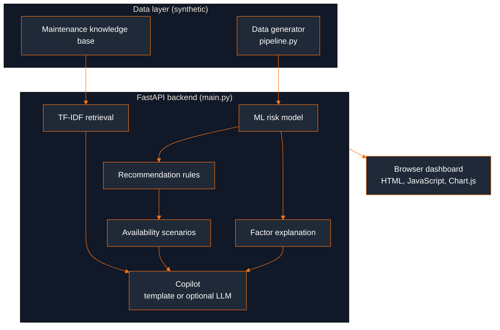

<div align="center">

# ✈️ AirPower-PM

### Predict the failure. Prioritize the aircraft. Protect fleet availability.

An explainable AI platform that predicts aircraft failure risk, explains the reasons, **prioritizes aircraft for maintenance**, recommends inspections and windows, and estimates the effect on **fleet availability**, with a retrieval-grounded **AI Maintenance Copilot**.

Built for **SIH26249: Air Power, Predictive Maintenance & Fleet Availability** (Smart India Hackathon 2026, Software, Transportation & Logistics)

<br/>


<br/>

**Jump straight to a module**, presented in the order a maintenance team uses them: **monitor → predict → plan → ask**

[](#-fleet-monitoring)
[](#-prediction--recommendation)
[](#%EF%B8%8F-fleet-availability)
[](#-ai-maintenance-copilot)

</div>

> **Prototype notice:** this project uses **synthetic/demo data only**. Aircraft IDs, aircraft types, sensor values, work orders and availability figures are generated for demonstration. They do not represent real aircraft, real maintenance records or real performance. The project is not affiliated with the Indian Air Force or the Ministry of Defence, and it has not been deployed on any real aircraft.

---

## 📚 Table of Contents

- [What is AirPower-PM?](#-what-is-airpower-pm)
- [Problem We Solve](#-problem-we-solve)
- [Our Solution](#-our-solution)
- [AirPower-PM Ecosystem](#-airpower-pm-ecosystem)
- [User Roles](#-user-roles)
- [📊 Fleet Monitoring](#-fleet-monitoring)
- [🔮 Prediction & Recommendation](#-prediction--recommendation)
- [🛠️ Fleet Availability](#%EF%B8%8F-fleet-availability)
- [🤖 AI Maintenance Copilot](#-ai-maintenance-copilot)
- [Flow Diagrams](#-flow-diagrams)
  - [Monitoring Flow](#-monitoring-flow)
  - [Prediction Flow](#-prediction-flow)
  - [Availability Flow](#-availability-flow)
  - [Copilot Flow](#-copilot-flow)
  - [How the flows connect](#-how-the-flows-connect)
- [System Architecture](#-system-architecture)
- [Tech Stack](#-tech-stack)
- [Project Structure](#-project-structure)
- [Suggested 3-Minute Demo](#-suggested-3-minute-demo)
- [Getting Started](#-getting-started)
- [Environment Variables](#-environment-variables)
- [Running the Project](#-running-the-project)
- [API Reference](#-api-reference)
- [Testing](#-testing)
- [Security](#-security)
- [Future Scope](#-future-scope)
- [Contribution](#-contribution)
- [License](#-license)
- [Team](#-team)

---

## 🌟 What is AirPower-PM?

Maintenance of an air fleet is largely reactive and fragmented. Health-monitoring data, technical records, spares and maintenance-agency information sit in separate places, so faults are predicted late, aircraft are grounded unexpectedly and critical assets are under-used.

AirPower-PM is a **decision-support prototype** that connects these pieces: an **ML risk model** on one side, a **prioritisation and recommendation layer** in the middle, and a **fleet-level availability view** on the other, with a **retrieval-grounded copilot** that explains every result to the maintenance team.

## 🎯 Problem We Solve

- Aircraft health data, technical records, spares and agency data are **not integrated**, so fault prediction is delayed.
- Maintenance is mostly **reactive**: aircraft are inspected after faults appear, causing avoidable downtime.
- A failure score alone does not tell planners **which aircraft to handle first** or **when**.
- The effect of upcoming maintenance on **fleet availability** is rarely visible to decision makers.
- Maintenance teams need **explanations**, not black-box scores, to trust and act on a prediction.

## 💡 Our Solution

AirPower-PM goes beyond predicting a failure. It follows one decision chain from data to fleet planning:

```
DATA → PREDICT → EXPLAIN → PRIORITIZE → RECOMMEND → PLAN FLEET AVAILABILITY
```

| # | Module | Built for | Role |
|---|---|---|---|
| 1 | **📊 Fleet Monitoring** | Maintenance officers, planners | Fleet status, risk distribution, searchable fleet, aircraft detail and maintenance records |
| 2 | **🔮 Prediction & Recommendation** | Maintenance officers | 30-day failure probability, risk class, "why is the risk high?", recommended inspection, priority and window |
| 3 | **🛠️ Fleet Availability** | Fleet planners | Current vs reactive vs planned availability and workload per maintenance window |
| 4 | **🤖 AI Maintenance Copilot** | Everyone | Grounded explanations with sources, built from the ML output and a maintenance knowledge base |

> **Important AI design rule:** the LLM does **not** predict failures. The ML model performs the prediction. The copilot only retrieves fleet data and maintenance knowledge and explains the model's output.

---

## 🏗️ AirPower-PM Ecosystem



> **Reading note:** the dashboard follows the maintenance team's workflow. They first see the fleet, then drill into a risky aircraft, then see what to do and what it means for availability. The copilot is available at any point to explain a result.

## 👥 User Roles

Two demo accounts are provided at login. The role is currently a **label only**; both accounts see all modules.

### 🧑‍🔧 Maintenance Officer
Reviews aircraft risk, reads the factors behind a prediction, checks work orders and requests inspections.

### 🗓️ Fleet Planner
Looks at fleet availability, maintenance workload per window and the priority queue.

---

## 📊 Fleet Monitoring

*Overview · Aircraft Fleet · Aircraft Detail · Maintenance Records*

**Flow:** `Login` → `Overview` → `Aircraft Fleet (search / filter)` → `Aircraft Detail` → `Maintenance Records`

| Screen | What it offers |
|---|---|
| **Overview** | KPI strip (total, available, under maintenance, high risk, availability), risk distribution, aircraft requiring attention, recent maintenance events and a fleet table |
| **Aircraft Fleet** | Search by ID; filters for risk, availability, maintenance status and aircraft type; sortable columns; result count; empty state with "Clear filters" |
| **Aircraft Detail** | Health index, failure probability, risk class, latest readings with units, 30-day vibration and temperature trends, and that aircraft's work-order history |
| **Maintenance Records** | About 75 synthetic work orders (aircraft, date, component, type, team, status, remarks) with search and filters |

## 🔮 Prediction & Recommendation

*One page with two clearly separated panels: the prediction and the recommended action*

**Flow:** `Select aircraft` → `Prediction (ML model)` → `Why is the risk high?` → `Recommended action` → `Request inspection (with confirmation)`

| Panel | Content |
|---|---|
| **1 · Prediction (ML model)** | 30-day failure probability, LOW / MEDIUM / HIGH class with a threshold marker, and ranked contributing factors with the aircraft's value against the fleet mean |
| **2 · Recommended action (rule layer)** | Predicted issue, risk level, recommended inspection, priority in the queue, suggested maintenance window and reason |

### 🧠 How the prediction works

- **Data:** `pipeline.py` generates 4,000 labelled synthetic records with flight hours, engine temperature, oil pressure, vibration, fuel flow, hydraulic pressure, brake temperature, component age, previous failures, maintenance count, days since last maintenance and the target `failure_next_30_days`.
- **Model:** a gradient boosting classifier trained at startup. The reported AUC is measured on a held-out split of the same synthetic data, so it shows the pipeline works. **It is not a real-world accuracy claim.**
- **Risk classes:** MEDIUM at 30% or more, HIGH at 60% or more.
- **Explanations:** model feature importance multiplied by a direction-aware deviation from the fleet mean. Only factors worse than normal are shown. SHAP is the production upgrade.
- **Recommendations:** a rule layer maps the dominant factor to an inspection type. Aircraft are queued by probability and placed in windows, assuming 2 inspection bays and 3-day slots (`BAYS`, `SLOT` in `main.py`).

## 🛠️ Fleet Availability

*Current vs reactive vs planned availability, workload and priority aircraft*

| Element | Purpose |
|---|---|
| **KPI strip** | Current availability, HIGH-risk aircraft available, under maintenance, reactive scenario, planned (peak) scenario |
| **Scenario chart** | Compares the three availability figures |
| **Workload by window** | Aircraft queued per maintenance window against bay capacity |
| **Priority aircraft** | Sortable queue; each row opens that aircraft's prediction page |

**Methodology (all figures are illustrative scenarios on synthetic data):**
- Current availability = available aircraft / total aircraft.
- Reactive scenario = available aircraft minus the expected failures (sum of failure probabilities of HIGH-risk available aircraft).
- Planned scenario = aircraft removed at the busiest point, limited by bay capacity.

## 🤖 AI Maintenance Copilot

*A chat interface that explains results. It does not predict.*

**Flow:** `Ask a question` → `Fleet data + ML output retrieved` → `Knowledge base retrieved` → `Template or optional LLM answer` → `Answer with sources and grounding facts`

- Suggested questions: "Why is aircraft A017 classified as high risk?", "Which aircraft should be inspected first?", "What factors are increasing A017's risk?", "How could the predicted maintenance affect fleet availability?"
- A side panel shows the pipeline (ML model → prediction; retrieval and LLM → explanation) and the exact **grounding facts** used for the last answer.
- Retrieval uses TF-IDF over a small maintenance knowledge base. Without an API key, a deterministic grounded answer is shown. With `ANTHROPIC_API_KEY` set, an LLM phrases the answer using only the retrieved context.

---

## 🔄 Flow Diagrams

Four detailed flows, one per module, in the same monitor → predict → plan → ask order, followed by how they connect.

### 📊 Monitoring Flow



### 🔮 Prediction Flow



### 🛠️ Availability Flow



### 🤖 Copilot Flow



### 🔗 How the flows connect



- **From monitoring to prediction:** clicking an aircraft anywhere (tables, attention lists, priority queue) opens its detail or prediction page.
- **From prediction to planning:** the same probabilities that classify risk drive the priority queue and the availability scenarios, so the three modules never disagree.
- **Copilot:** every answer is built from the same backend results the dashboard shows, and it lists its sources.

## 🧩 System Architecture



| Layer | Responsibility | Does NOT do |
|---|---|---|
| ML model | Predicts 30-day failure probability and risk class | Write explanations |
| Rule layer | Maps risk factors to inspections, priority and windows | Predict failures |
| Retrieval + LLM (optional) | Explains the prediction using data and maintenance knowledge, with sources | Predict failures or invent data |

> **Current state:** the prototype is one FastAPI app serving one HTML page. All data is **synthetic and generated in memory at startup**, with no database and no real aircraft integration. Login uses hard-coded demo users with in-memory tokens. This is intentional for the hackathon prototype stage. See [Future Scope](#-future-scope) for the planned production path.

## 🛠️ Tech Stack

**Currently used, for building the prototype in this repo:**


**Optional:**


**Planned for future implementation, not built yet:**


| Layer | Technology | Purpose |
|---|---|---|
| Backend API | FastAPI, Uvicorn, Pydantic | JSON API, demo login, serving the dashboard |
| ML model | scikit-learn `GradientBoostingClassifier` | 30-day failure probability |
| Data | pandas, NumPy | Synthetic data generation and processing |
| Retrieval | scikit-learn TF-IDF | Grounding the copilot in maintenance knowledge |
| GenAI (optional) | Anthropic API | Phrasing grounded answers from retrieved context |
| Frontend | HTML, vanilla JavaScript | Single-page dashboard with hash routing |
| Charts | Chart.js (cdnjs) | Sensor trends and availability scenarios |
| State | In-memory (server), `sessionStorage` (browser) | Demo session, chat history, inspection requests |

## 📂 Project Structure

```
airpower-pm/
├── backend/
│   ├── main.py              # FastAPI app: risk logic, plan, availability, copilot, records, demo auth
│   ├── pipeline.py          # synthetic data generation, model training, sensor history
│   └── static/
│       └── index.html       # complete dashboard (login, 8 screens)
├── requirements.txt
├── SUBMISSION.md            # SIH submission text, slide outline, jury Q&A
├── LICENSE
├── .gitignore
└── README.md
```


## ⚙️ Getting Started

### Prerequisites
- [Python](https://www.python.org/downloads/) 3.10 or newer
- A modern browser, with internet access for Chart.js (loaded from cdnjs)
- Git (to clone the repository)

### Clone the repository
```bash
git clone https://github.com/preetkukreja556-beep/airpower-pm.git
cd airpower-pm
```

### Install (Windows PowerShell)
```powershell
python -m venv .venv
.venv\Scripts\activate
pip install -r requirements.txt
```

If PowerShell blocks activation, run once: `Set-ExecutionPolicy -Scope CurrentUser RemoteSigned`.

## 🔐 Environment Variables

No environment variable is required. The prototype runs fully on synthetic data. The following are optional:

| Variable | Purpose | Default |
|---|---|---|
| `ANTHROPIC_API_KEY` | Enables LLM-phrased copilot answers | not set (template mode) |
| `LLM_MODEL` | Model used when the key is set | `claude-sonnet-5-5` |

```powershell
$env:ANTHROPIC_API_KEY="your_key_here"
```

Never commit a key. `.env` files are already in `.gitignore`.

## 🚀 Running the Project

```powershell
cd backend
uvicorn main:app --reload
```

Open **http://127.0.0.1:8000** and sign in with a demo account. The model trains at startup, which takes a few seconds.

| Username | Password | Role label |
|---|---|---|
| `officer` | `air@123` | Maintenance Officer |
| `planner` | `fleet@123` | Fleet Planner |

Next runs: activate the environment, `cd backend`, then run the same `uvicorn` command. Stop with `Ctrl + C`. Interactive API docs are at `/docs`.

| Problem | Fix |
|---|---|
| `Directory 'static' does not exist` | Run uvicorn from inside `backend` |
| `uvicorn is not recognized` | Activate the environment, or use `python -m uvicorn main:app --reload` |
| 401 errors or an old interface | Make sure `index.html` is the latest version, then press `Ctrl + F5` |
| Logged out after editing code | Expected: reload clears in-memory tokens |
| Charts are empty | Chart.js loads from the internet. Check your connection |
| Port 8000 in use | Add `--port 8001` and open that port |

## 📡 API Reference

All endpoints except `/api/login` require `Authorization: Bearer <token>`.

| Method | Endpoint | Purpose |
|---|---|---|
| POST | `/api/login` | Returns a token, name and role |
| GET | `/api/fleet` | Fleet summary and per-aircraft risk, status and action |
| GET | `/api/aircraft/{id}` | Probability, factors, predicted issue, sensors, 30-day history |
| GET | `/api/maintenance` | Prioritised inspection queue with windows and reasons |
| GET | `/api/availability` | Current and projected availability scenarios |
| GET | `/api/records` | Synthetic work orders |
| GET | `/api/system` | Model and system information |
| POST | `/api/copilot` | Question in; answer, sources and grounding facts out |

## 🧪 Testing

- The repository currently has **no automated test suite**. The API endpoints were smoke-tested manually with FastAPI's test client during development.
- Manual check: run the app, sign in, and open each of the 8 screens. Confirm the filters, sorting, aircraft selection, inspection request and copilot questions respond.
- Adding `pytest` tests for the API and the model pipeline is tracked under Future Scope.

## 🔒 Security

- Login is a **demo/prototype flow** with hard-coded users and in-memory tokens. The role is a label only. It is not real authentication.
- There is no database, no real aircraft data and no encryption layer in this prototype.
- No secrets or API keys are present in the codebase. The optional LLM key is read from an environment variable.
- **Production design intent (not implemented):** on-premise or air-gapped deployment, SSO with role-based access control, audit logging, encryption at rest and in transit, and a local LLM option so that no data leaves the environment.

## 🌍 Future Scope

*(Planned, not yet implemented)*

- Integration with real aircraft health-monitoring exports, technical records, spares and maintenance-agency data (after authorisation and anonymisation)
- Retraining and validation of the model on real data, with SHAP explanations and remaining-useful-life or survival models
- Spares, manpower and mission-criticality aware maintenance optimisation
- A digital twin per aircraft
- A vector store and LangChain-based retrieval over approved technical manuals, with a local LLM option
- PostgreSQL storage, streaming ingestion and containerised deployment (Docker)
- Real authentication, role-based access control and audit logs
- Automated tests and CI/CD
- A human feedback loop and a pilot validation with domain experts

## 🤝 Contribution

1. Fork the repository and create a feature branch: `git checkout -b feature/your-feature`
2. Make your changes in `backend/` (API and ML) or `backend/static/` (dashboard)
3. Run the app locally and check every screen before opening a PR
4. Commit with a clear message and open a Pull Request describing the change

## 📄 License

Released under the MIT License (see `LICENSE`). The license covers the code only. The synthetic data carries no real-world meaning.

> **Disclaimer:** this is a hackathon prototype built for demonstration. It must not be used for real maintenance decisions. Any use on real aircraft data would require retraining, validation, certification processes and a security review.

## 👨‍💻 Team

**Team Nous Cartel**

- Gauraansh Gaur (Team Leader)
- Preet Indrapal Kukreja
- Priyanka Bharti
- Mohd Owais
- Rohan Prasad
- Shivam Kumar

---

<div align="center">

Built for **SIH26249**: Air Power, Predictive Maintenance & Fleet Availability

[⬆ Back to top](#-airpower-pm)

</div>
